# Бесконечный режим: устройство кода

Схемы кода бесконечного режима. Сейчас здесь каркас — этап 2 плана «Бесконечный уровень»; боссы, множитель здоровья,
погода, окно режима и рекорд дописываются по ходу следующих этапов. Пути — от `Assets/_Project/Develop/`, имя файла
совпадает с именем класса.

Схемы нарисованы в Mermaid: их рисуют предпросмотр Markdown в VS Code (расширение Markdown Preview Mermaid Support) и
GitHub.

Термины:
- **Волна** — то, что в коде называется стейджем (`EnemiesWavesStageConfig`, `EnemiesWavesStage`). HUD пишет «Волна N».
- **Поток** — `EnemiesWaveConfig` внутри волны: одна дорога, интервал между врагами, группы врагов. У волны бесконечного
  режима по потоку на каждую дорогу уровня.

Цвета на схемах:

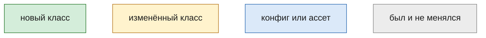

## 1. Общая картина

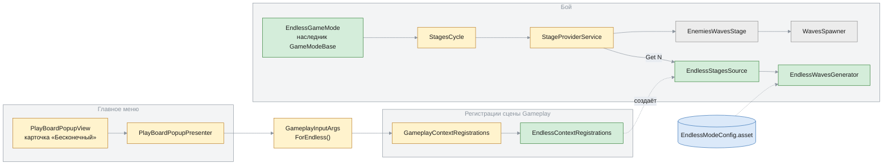

Конфиг волны, который собирает генератор, — обычный `EnemiesWavesStageConfig`, тот же, что у стейджей кампании.
Поэтому `EnemiesWavesStage` и `WavesSpawner` бесконечный режим не меняет.

## 2. Регистрации: чем бесконечный уровень отличается от кампании

Отличий три: откуда взять `LevelConfig`, источник волн и списки для подготовки уровня. Всё остальное в сцене общее.

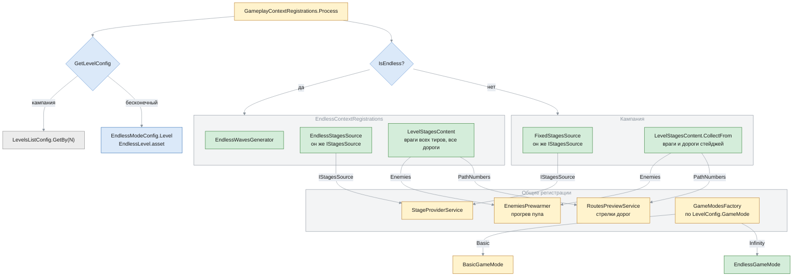

## 3. Бой

### Иерархии

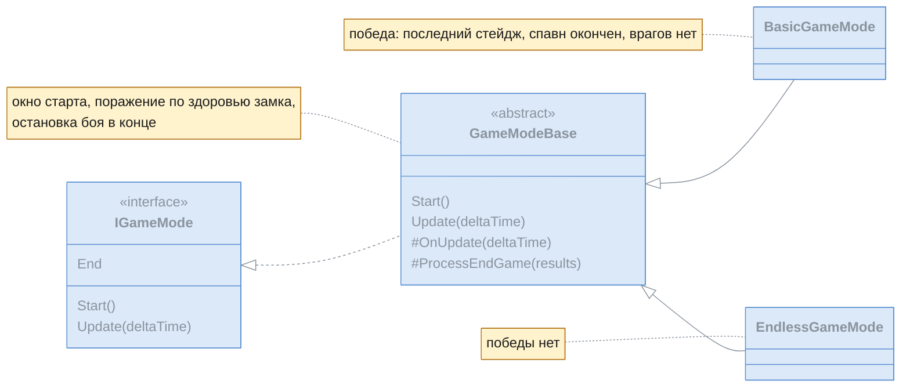

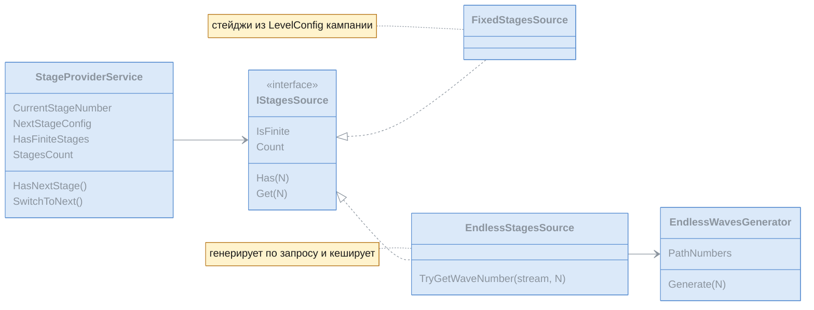

У бесконечного источника `Count` нет, поэтому HUD (`StagesStatusPresenter`) пишет «Волна N» без «/M».

### Жизнь одной волны

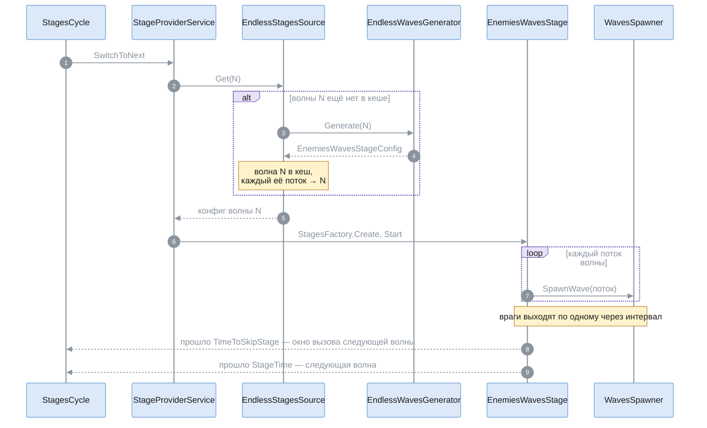

Окна старта и вызова показывают состав следующей волны заранее (`NextStageConfig`), поэтому источник кеширует волну:
спавн должен получить тот же самый объект. По потоку этап 3 узнаёт номер волны заспавненного врага —
`TryGetWaveNumber`.

### Конец игры — общий для обоих режимов

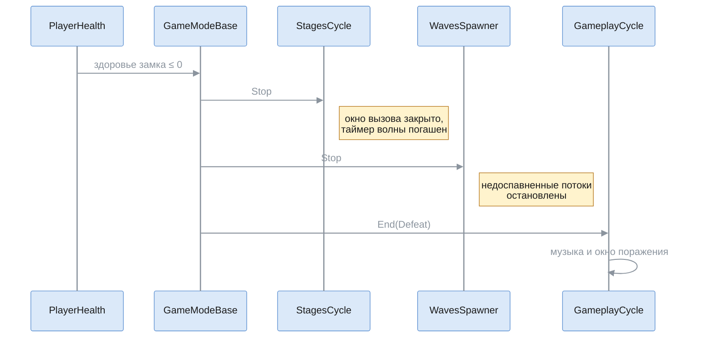

Раньше таймер волны — корутина — после поражения доходил до конца и запускал следующую волну. Поражение срабатывает
один раз: после итога падение здоровья замка ничего не делает.

## 4. Генератор волн

`EndlessWavesGenerator` (`Runtime/Gameplay/Features/EndlessMode/`) превращает номер волны в `EnemiesWavesStageConfig`.
Состояния забега у него нет: всё берётся из конфига и номера волны. Поэтому волна N всегда одна и та же, а таблицу волн
в инспекторе строит тот же генератор.

### Шаги — на примере волны 12

Числа — из текущего чернового конфига; их же показывает таблица волн в инспекторе.

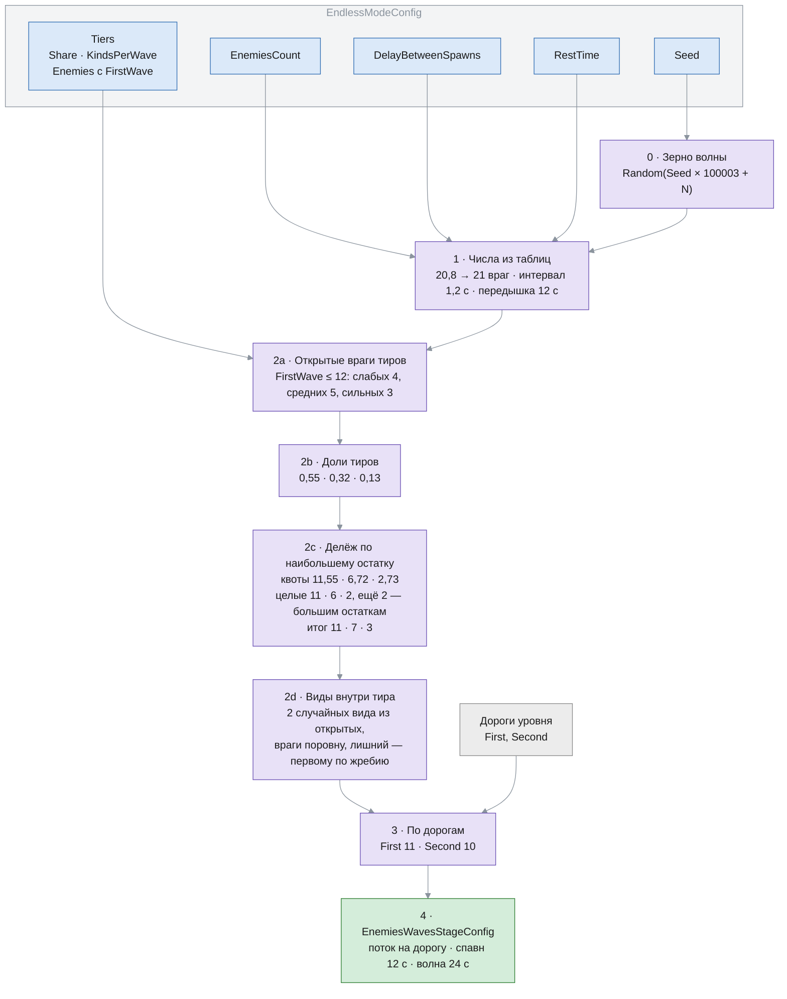

- **Зерно** у каждой волны своё: состав волны не зависит от того, какие волны собирались раньше.
- **Тир без открытых врагов** получает долю 0, и она сама расходится по остальным тирам пропорционально.
- **Время волны:** спавн = (врагов на самой длинной дороге − 1) × интервал = (11 − 1) × 1,2 = 12 с. Окно вызова
  следующей волны (`TimeToSkipStage`) открывается после спавна — когда вышел последний враг. Вся волна (`StageTime`) —
  спавн плюс передышка: 12 + 12 = 24 с.

### Волна 12 по тирам и видам

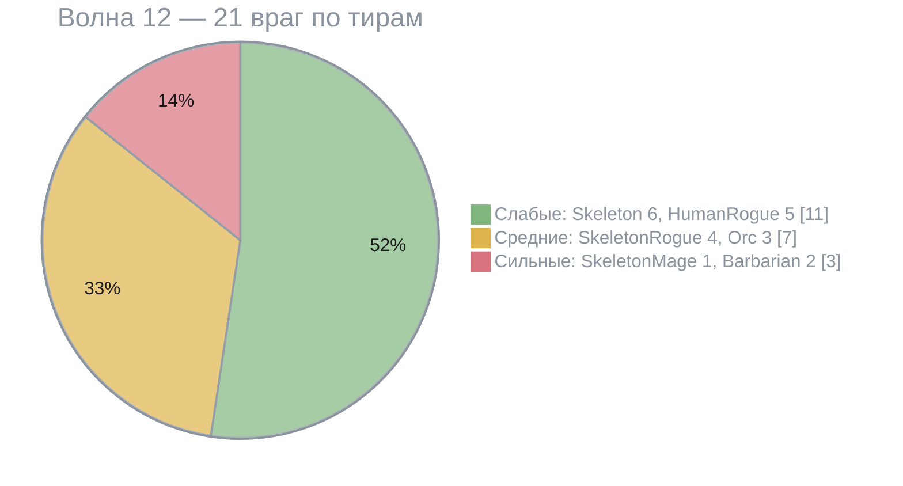

### Волна 12 по дорогам

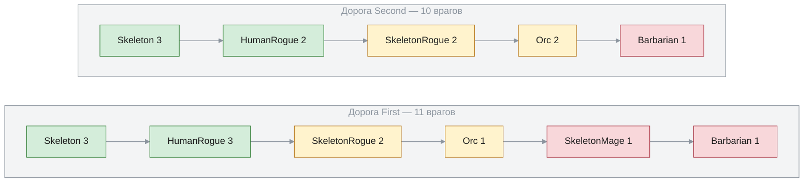

Стрелки — порядок выхода на дороге: сначала слабые, потом средние, потом сильные. Каждая группа волны делится между
дорогами поровну: Skeleton 6 — по 3, SkeletonRogue 4 — по 2. Лишние раздаются по очереди, и очередь идёт сквозь все
группы волны: лишний HumanRogue — на First, лишний Orc — уже на Second, единственный SkeletonMage — снова на First,
Barbarian 2 — по одному. Так лишние не копятся на первой дороге.

### Волны 1–25

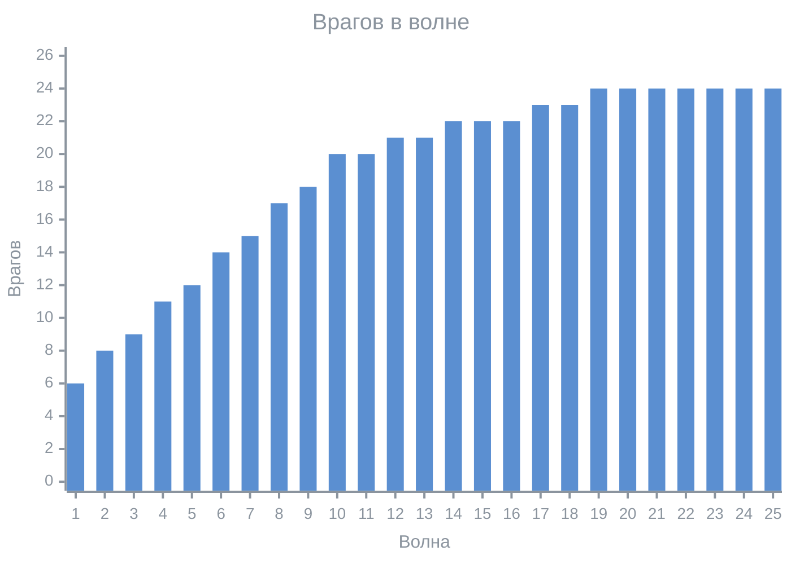

| Волна | 1 | 5 | 10 | 15 | 20 | 30 |
|---|---|---|---|---|---|---|
| Слабые | 6 | 10 | 12 | 10 | 8 | 8 |
| Средние | 0 | 2 | 6 | 8 | 10 | 10 |
| Сильные | 0 | 0 | 2 | 4 | 6 | 6 |

Рост 1–10 идёт за счёт числа врагов, на 10–20 сильные тиры вытесняют слабых, после 20 держится плато, а виды внутри
тиров меняются от волны к волне.

### Таблица значений по волнам — WaveValueTable

Все числа режима, которые меняются от волны к волне, — такие таблицы: ключи «волна → значение» плюс режим хвоста.

Пример — `EnemiesCount` с ключами 1 → 6, 10 → 20, 20 → 24:

| Волна | 1 | 5 | 10 | 12 | 20 | 30 |
|---|---|---|---|---|---|---|
| Значение | 6 | 12,2 | 20 | 20,8 | 24 | Hold: 24 · Linear, шаг 1: 34 · Compound, шаг 0,05: ≈ 39,1 |

Пустая таблица — ошибка конфига: инспектор показывает её, а в игре `GetValue` бросает исключение, а не отдаёт ноль.

### Что генератор читает

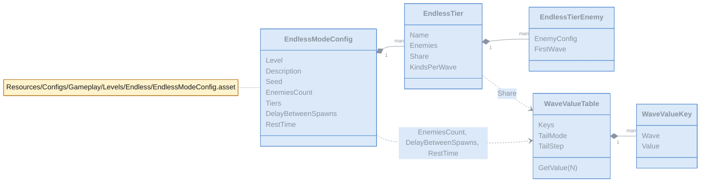

Классы конфигов лежат в `Runtime/Configs/Gameplay/Levels/Endless/`. Тиры идут в порядке выхода на дорогу: слабые,
средние, сильные.

## 5. Инспектор конфига — только в редакторе

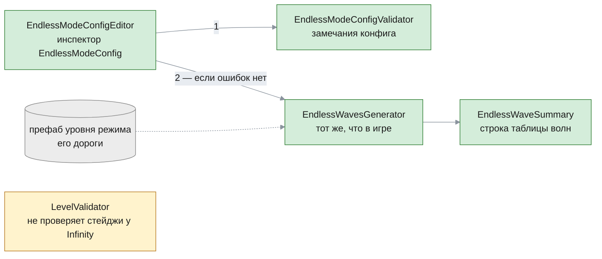

- **Замечания:** пустые таблицы, ключи не по возрастанию, нет уровня, префаба или дорог — ошибки, и тогда таблица волн
  не строится. Режим уровня не `Infinity`, стейджи у уровня, пустой тир или элемент, босс в тире — предупреждения.
- **Таблица:** волна, врагов, по тирам, состав (имена ассетов в порядке тиров), спавн, длительность. Число волн в
  таблице (по умолчанию 40) хранится в `EditorPrefs`, а не в ассете.

## 6. Куда пристраиваются следующие этапы

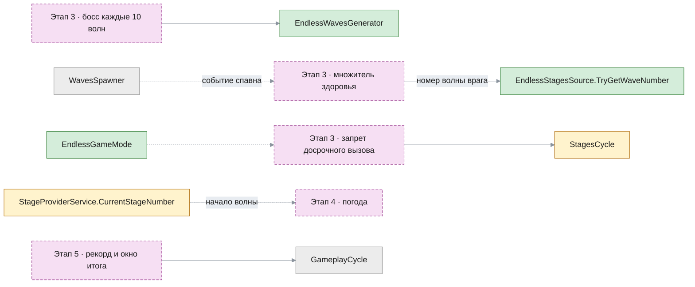

## 7. Файлы

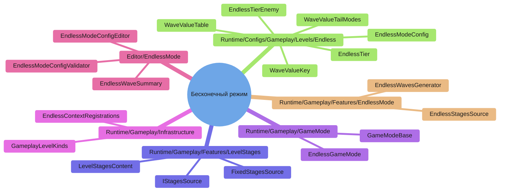

Новые файлы — на схеме выше. Изменённые:

| Папка | Файл | Что изменилось |
|---|---|---|
| `Runtime/Configs/Gameplay/Levels/Stages/` | `EnemiesWavesStageConfig`, `EnemiesWaveConfig`, `WaveEnemyGroup` | конструкторы для сборки в коде |
| `Runtime/Gameplay/Features/LevelStages/` | `StageProviderService`, `StagesCycle` | работают через источник; `Stop` гасит волну |
| `Runtime/Gameplay/GameMode/` | `BasicGameMode`, `GameModesFactory` | наследник `GameModeBase`; ветка `Infinity` |
| `Runtime/Gameplay/Infrastructure/` | `GameplayInputArgs`, `GameplayContextRegistrations`, `GameplayBootstrap` | кампания или бесконечный; развилка регистраций |
| `Runtime/Gameplay/Features/Enemies/` | `EnemiesPrewarmer` | прогрев по готовому списку врагов |
| `Runtime/Gameplay/Features/RoutesPreview/` | `RoutesPreviewService` | стрелки по готовому списку дорог |
| `Runtime/UI/Gameplay/` | `StagesStatusPresenter`, `PausePopupPresenter`, `DefeatPopupPresenter` | «Волна N»; «Заново» — тот же уровень |
| `Runtime/UI/Meta/` | `PlayBoardPopupView`, `PlayBoardPopupPresenter`, `MainMenuPresentersFactory`, `LevelTilePresenter` | щелчок по карточке → бой |
| `Runtime/Utilities/ConfigsManagment/` | `ResourcesConfigsLoader` | путь к `EndlessModeConfig` |
| `Editor/LevelEditor/` | `LevelValidator`, `PlaytestSession` | уровень `Infinity` без стейджей; `ForCampaign` |
