# Бесконечный режим: устройство кода

Схемы кода бесконечного режима: каркас — этап 2 плана «Бесконечный уровень», боссы, множитель здоровья, запрет
досрочного вызова, музыка после босса и старт с волны N — этап 3 (раздел 5), погода — этап 4 (раздел 6). Окно режима и
рекорд дописываются по ходу следующих этапов. Пути — от `Assets/_Project/Develop/`, имя файла
совпадает с именем класса.

Схемы нарисованы в Mermaid: их рисуют предпросмотр Markdown в VS Code (расширение Markdown Preview Mermaid Support) и
GitHub.

Термины:
- **Волна** — то, что в коде называется стейджем (`EnemiesWavesStageConfig`, `EnemiesWavesStage`). HUD пишет «Волна N».
- **Поток** — `EnemiesWaveConfig` внутри волны: одна дорога, интервал между врагами, группы врагов. У волны бесконечного
  режима по потоку на каждую дорогу уровня.

Цвета на схемах — по отношению к коду до бесконечного режима; в разделе 5 — по отношению к коду этапа 2, в разделе 6 —
к коду этапа 3:

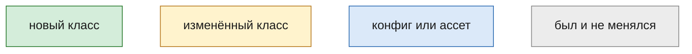

## 1. Общая картина

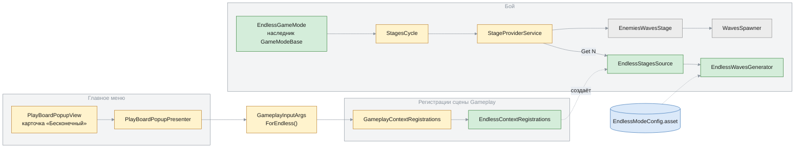

Конфиг волны, который собирает генератор, — обычный `EnemiesWavesStageConfig`, тот же, что у стейджей кампании.
Поэтому `EnemiesWavesStage` и `WavesSpawner` бесконечный режим не меняет.

## 2. Регистрации: чем бесконечный уровень отличается от кампании

Отличий три: откуда взять `LevelConfig`, источник волн и списки для подготовки уровня. Всё остальное в сцене общее.

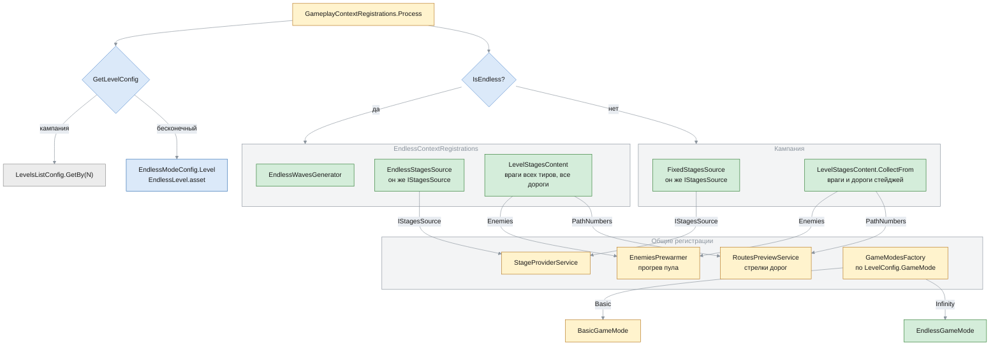

## 3. Бой

### Иерархии

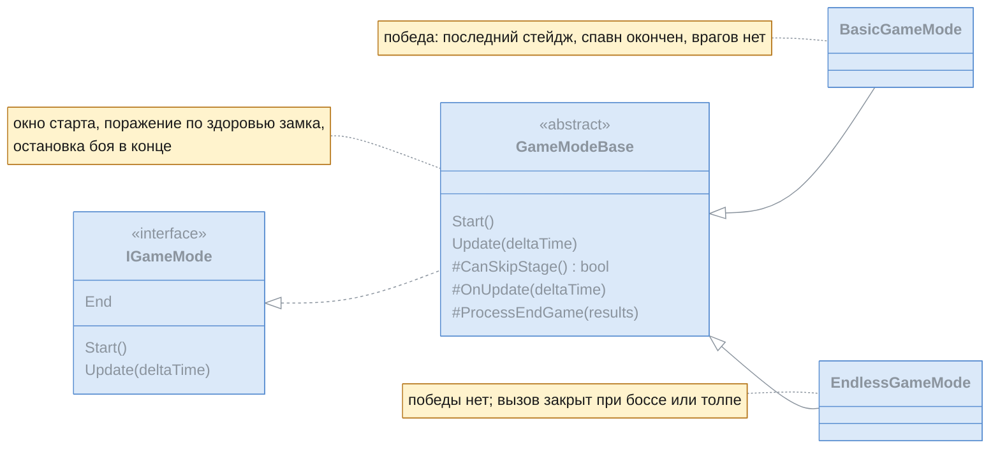

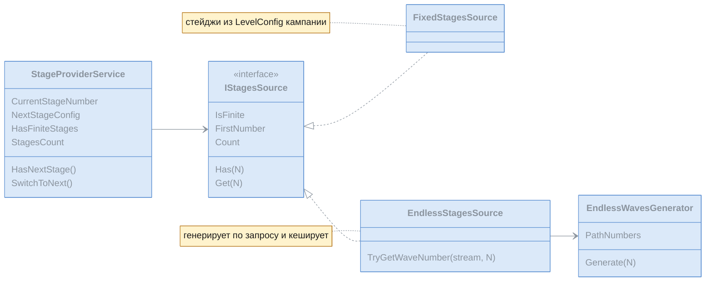

У бесконечного источника `Count` нет, поэтому HUD (`StagesStatusPresenter`) пишет «Волна N» без «/M».

### Жизнь одной волны

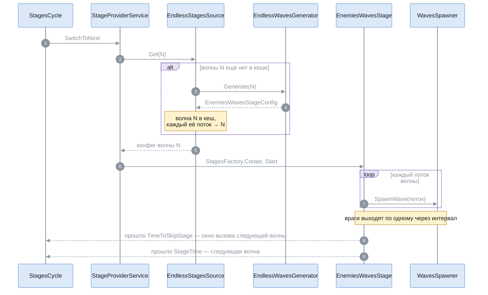

Окна старта и вызова показывают состав следующей волны заранее (`NextStageConfig`), поэтому источник кеширует волну:
спавн должен получить тот же самый объект. По потоку этап 3 узнаёт номер волны заспавненного врага —
`TryGetWaveNumber`.

### Конец игры — общий для обоих режимов

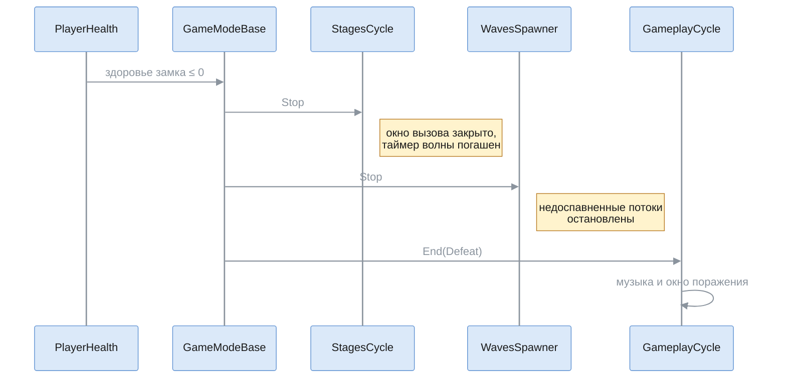

Раньше таймер волны — корутина — после поражения доходил до конца и запускал следующую волну. Поражение срабатывает
один раз: после итога падение здоровья замка ничего не делает.

## 4. Генератор волн

`EndlessWavesGenerator` (`Runtime/Gameplay/Features/EndlessMode/`) превращает номер волны в `EnemiesWavesStageConfig`.
Состояния забега у него нет: всё берётся из конфига и номера волны. Поэтому волна N всегда одна и та же, а таблицу волн
в инспекторе строит тот же генератор.

### Шаги — на примере волны 12

Числа — из текущего чернового конфига; их же показывает таблица волн в инспекторе.

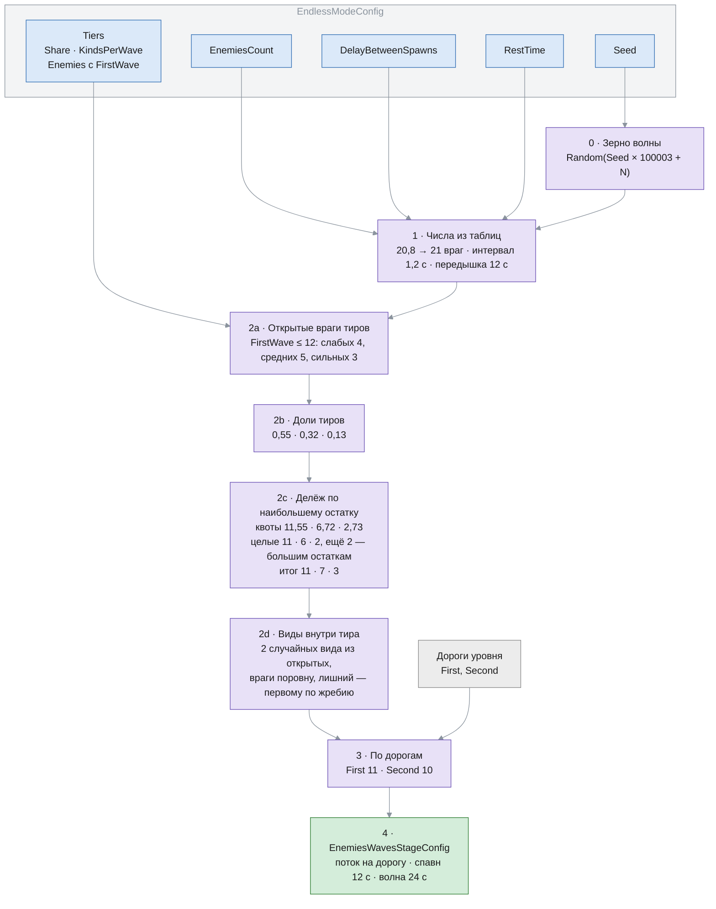

- **Зерно** у каждой волны своё: состав волны не зависит от того, какие волны собирались раньше.
- **Тир без открытых врагов** получает долю 0, и она сама расходится по остальным тирам пропорционально.
- **Время волны:** спавн = (врагов на самой длинной дороге − 1) × интервал = (11 − 1) × 1,2 = 12 с. Окно вызова
  следующей волны (`TimeToSkipStage`) открывается после спавна — когда вышел последний враг. Вся волна (`StageTime`) —
  спавн плюс передышка: 12 + 12 = 24 с.

### Волна 12 по тирам и видам

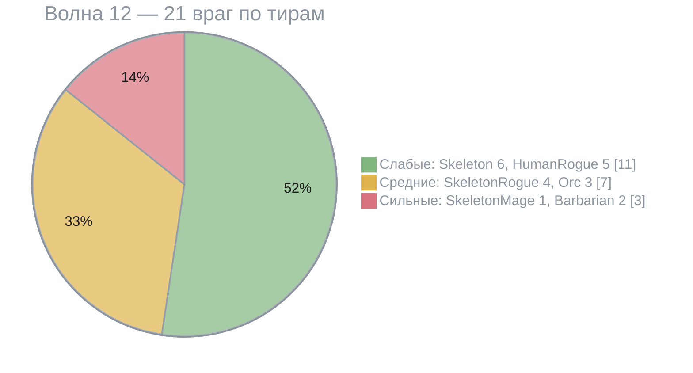

### Волна 12 по дорогам

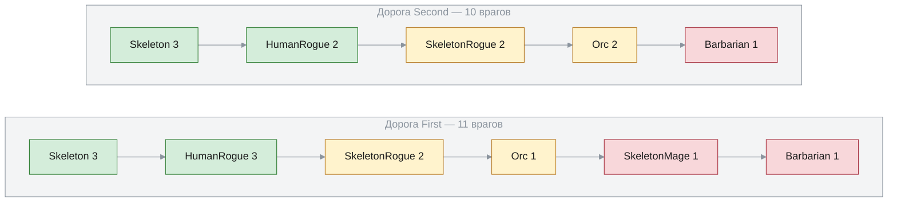

Стрелки — порядок выхода на дороге: сначала слабые, потом средние, потом сильные. Каждая группа волны делится между
дорогами поровну: Skeleton 6 — по 3, SkeletonRogue 4 — по 2. Лишние раздаются по очереди, и очередь идёт сквозь все
группы волны: лишний HumanRogue — на First, лишний Orc — уже на Second, единственный SkeletonMage — снова на First,
Barbarian 2 — по одному. Так лишние не копятся на первой дороге.

### Волны 1–25

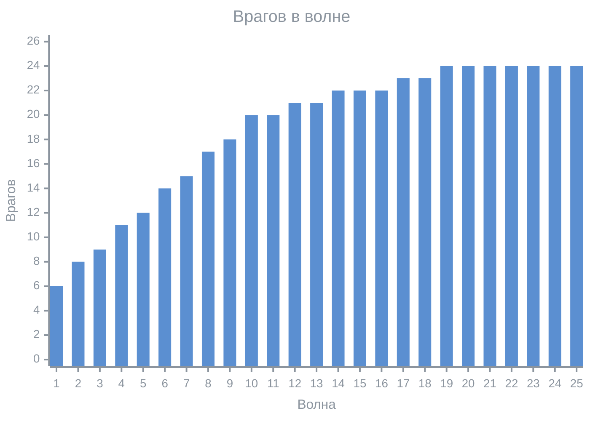

| Волна | 1 | 5 | 10 | 15 | 20 | 30 |
|---|---|---|---|---|---|---|
| Слабые | 6 | 10 | 12 | 10 | 8 | 8 |
| Средние | 0 | 2 | 6 | 8 | 10 | 10 |
| Сильные | 0 | 0 | 2 | 4 | 6 | 6 |

Рост 1–10 идёт за счёт числа врагов, на 10–20 сильные тиры вытесняют слабых, после 20 держится плато, а виды внутри
тиров меняются от волны к волне.

### Таблица значений по волнам — WaveValueTable

Все числа режима, которые меняются от волны к волне, — такие таблицы: ключи «волна → значение» плюс режим хвоста.

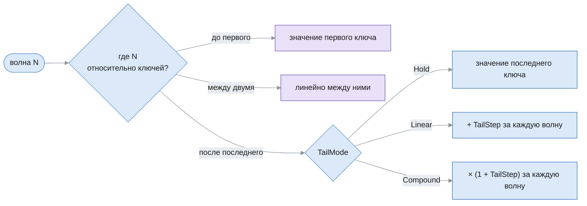

Пример — `EnemiesCount` с ключами 1 → 6, 10 → 20, 20 → 24:

| Волна | 1 | 5 | 10 | 12 | 20 | 30 |
|---|---|---|---|---|---|---|
| Значение | 6 | 12,2 | 20 | 20,8 | 24 | Hold: 24 · Linear, шаг 1: 34 · Compound, шаг 0,05: ≈ 39,1 |

Пустая таблица — ошибка конфига: инспектор показывает её, а в игре `GetValue` бросает исключение, а не отдаёт ноль.

### Что генератор читает

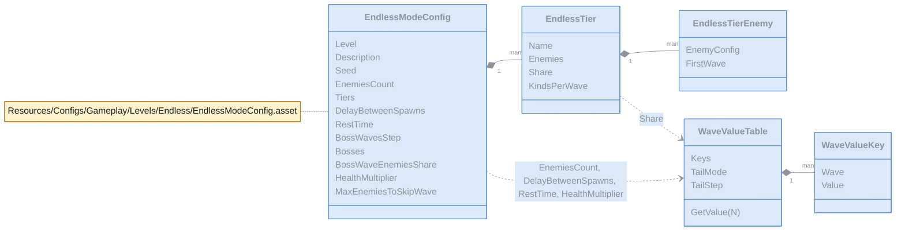

Классы конфигов лежат в `Runtime/Configs/Gameplay/Levels/Endless/`. Тиры идут в порядке выхода на дорогу: слабые,
средние, сильные.

## 5. Боссы, рост здоровья, запрет вызова, музыка — этап 3

Пять дополнений к каркасу. Каждое живёт в своём классе, а в общий код боя добавлены только точки подключения: событие
спавна у `WavesSpawner`, разрешение режима у `StagesCycle`, номер первой волны у источника стейджей.

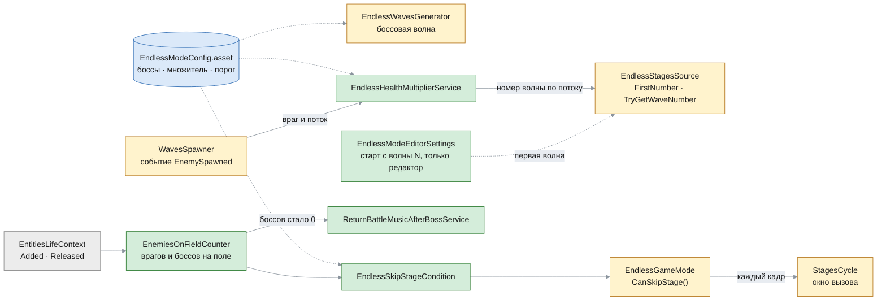

Всё новое регистрирует `EndlessContextRegistrations`: в кампании этих классов нет, и она работает как раньше — режим
кампании вызов не запрещает.

### Боссовая волна — на примере волны 10

Каждая волна с номером, кратным шагу (`BossWavesStep` = 10), — боссовая. Числа — из текущего чернового конфига.

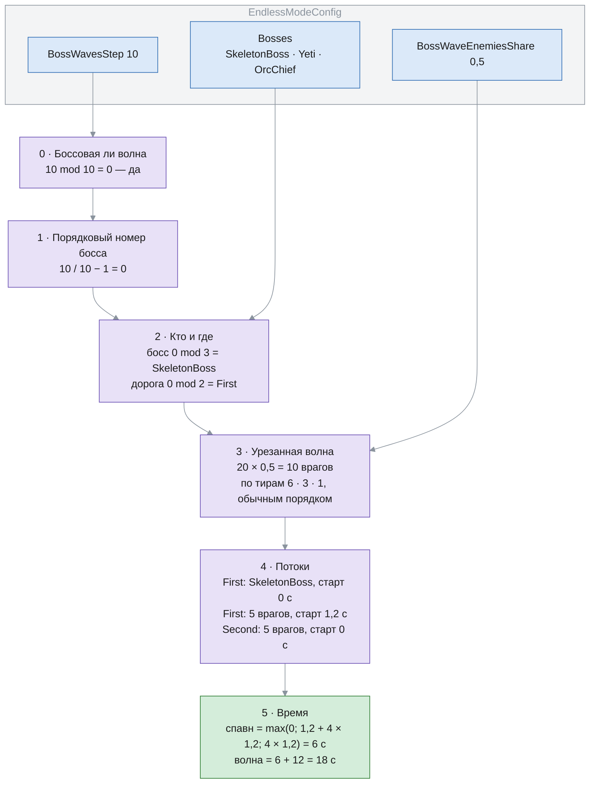

- **Босс** выходит первым отдельным потоком. Обычные враги на его дороге стартуют через один интервал, чтобы не
  появиться в той же точке одновременно с ним, — как йети на Level_8.
- **Время спавна** теперь считается по самому позднему потоку с учётом задержки старта: старт + (врагов − 1) × интервал.
- **Боссы по кругу, дорога — по очереди.** `TryGetBoss(N)` открыт и для инспектора: таблица волн показывает босса
  отдельным столбцом.

| Волна | 10 | 20 | 30 | 40 | 50 | 60 |
|---|---|---|---|---|---|---|
| Босс | SkeletonBoss | Yeti | OrcChief | SkeletonBoss | Yeti | OrcChief |
| Дорога | First | Second | First | Second | First | Second |
| Обычных врагов | 10 из 20 | 12 из 24 | 12 из 24 | 12 из 24 | 12 из 24 | 12 из 24 |

Боссы прогреваются вместе с врагами тиров: `EndlessContextRegistrations` добавляет их в `LevelStagesContent.Enemies`.

### Множитель здоровья

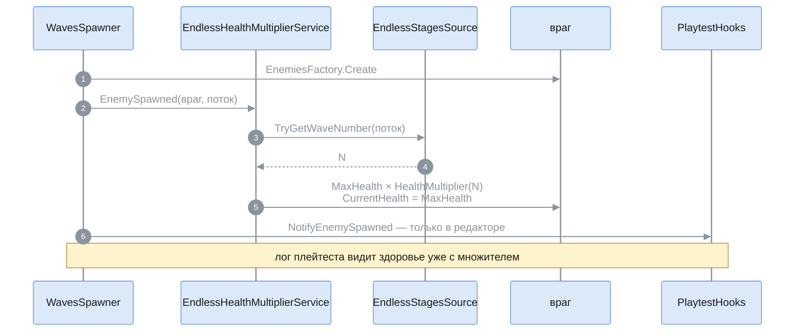

- **Номер волны берётся по потоку**, а не по текущей волне: враги прошлых волн, которые ещё идут, остаются со своим
  множителем.
- **Призванные — без множителя.** `SummonOnAnimationEventSystem` зовёт `EnemiesFactory.Create` мимо спавнера, и события
  о них нет.
- **Проверено в бою** на волне 25: Barbarian 600 → 730, Skeleton 20 → 24,3, а призванный некромантом скелет — 20.

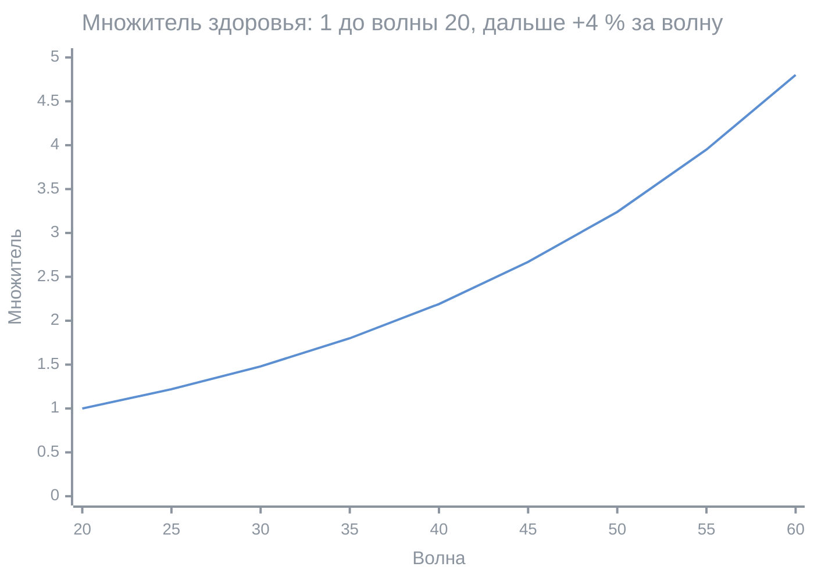

Таблица `HealthMultiplier`: ключи 1 → 1, 20 → 1, хвост `Compound` с шагом 0,04 — значение волны 20 + k равно 1,04^k.

### Запрет досрочного вызова

```mermaid
%%{init: {"theme": "base", "themeVariables": {"primaryColor": "#dbe9f9", "primaryTextColor": "#1b1b1b", "primaryBorderColor": "#5b8fd1", "lineColor": "#8b949e", "textColor": "#8b949e", "edgeLabelBackground": "#e8ecf1", "clusterBkg": "rgba(139,148,158,0.10)", "clusterBorder": "#8b949e", "titleColor": "#8b949e"}}}%%
flowchart LR
    classDef new fill:#d4edda,stroke:#2e7d32,color:#1b1b1b
    classDef changed fill:#fff3cd,stroke:#b7791f,color:#1b1b1b
    classDef config fill:#dbe9f9,stroke:#2f6db3,color:#1b1b1b
    classDef old fill:#ececec,stroke:#8a8a8a,color:#1b1b1b

    Life["EntitiesLifeContext"]:::old
    Counter["EnemiesOnFieldCounter<br/>EnemiesCount · BossesCount"]:::new
    Skip["EndlessSkipStageCondition<br/>боссов 0 и врагов ≤ 40"]:::new
    Mode["EndlessGameMode.CanSkipStage()"]:::changed
    Base["GameModeBase.Update"]:::changed
    Cycle["StagesCycle.Update(dt, разрешено)"]:::changed
    Popup["SkipStagePopupPresenter<br/>закрывается на StageCanBeSkiped = false"]:::old

    Life -->|Added +1 · Released −1| Counter --> Skip --> Mode --> Base --> Cycle -->|StageCanBeSkiped| Popup
```

- **Счётчик** считает врагов по `Added` и `Released`, без обхода всех сущностей каждый кадр. Враг — сущность от
  `EnemiesFactory` (компонент `EnemyKind`), призванные тоже; снежки йети — снаряды команды врагов — в счёт не идут.
  Умирающий враг на поле до освобождения сущности, поэтому босс держит запрет ещё 1–5 с после смерти, пока полоска
  уходит.
- **У кампании** `CanSkipStage()` всегда `true` — разрешение по умолчанию в `GameModeBase`.

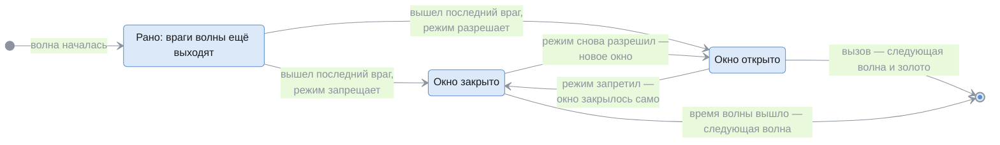

`StagesCycle` помнит, что стейдж уже позволил вызов, и каждый кадр сверяет это с разрешением режима. Каждое открытие —
новое окно: счётчик щелчков с нуля, золото — по оставшемуся времени волны.

### Боевая музыка после босса

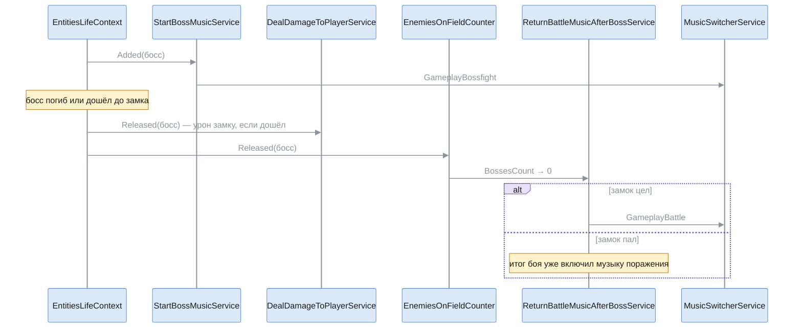

Только в бесконечном режиме: сервис регистрирует `EndlessContextRegistrations`, `StartBossMusicService` не менялся.
Бесконечный кончается только поражением, поэтому «конец игры» здесь — замок пал.

### Старт с волны N — только в редакторе

```mermaid
%%{init: {"theme": "base", "themeVariables": {"primaryColor": "#dbe9f9", "primaryTextColor": "#1b1b1b", "primaryBorderColor": "#5b8fd1", "lineColor": "#8b949e", "textColor": "#8b949e", "edgeLabelBackground": "#e8ecf1", "clusterBkg": "rgba(139,148,158,0.10)", "clusterBorder": "#8b949e", "titleColor": "#8b949e"}}}%%
flowchart LR
    classDef new fill:#d4edda,stroke:#2e7d32,color:#1b1b1b
    classDef changed fill:#fff3cd,stroke:#b7791f,color:#1b1b1b
    classDef config fill:#dbe9f9,stroke:#2f6db3,color:#1b1b1b
    classDef old fill:#ececec,stroke:#8a8a8a,color:#1b1b1b

    Inspector["EndlessModeConfigEditor<br/>поле «Старт с волны»"]:::changed
    Prefs["EndlessModeEditorSettings<br/>EditorPrefs, файл под #if UNITY_EDITOR"]:::new
    Reg["EndlessContextRegistrations"]:::changed
    Source["EndlessStagesSource(генератор, N)<br/>FirstNumber = N"]:::changed
    Provider["StageProviderService<br/>счёт с FirstNumber − 1"]:::changed
    Hud["HUD — «Волна N»<br/>первая волна боя — N"]:::old

    Inspector <--> Prefs
    Reg -->|"редактор: StartWaveNumber<br/>сборка: 1"| Source --> Provider --> Hud
    Prefs -.-> Reg
```

Значение живёт в `EditorPrefs`, а не в ассете: его не закоммитить случайно, и раскладка сериализации конфига одна для
редактора и сборки. Пока оно не 1, инспектор показывает предупреждение. Рекорд этапа 5 не пишется, если
`FirstNumber` источника больше 1. У кампании `FirstNumber` всегда 1.

## 6. Погода — этап 4

Три погоды — ясно, дождь, гроза — сменяют друг друга в начале волн. Код погоды общий (`Gameplay/Features/Weather/`,
конфиг — `Runtime/Configs/Gameplay/Weather/`), включают его только регистрации бесконечного режима, и только если в
`EndlessModeConfig` задана погода. Выборка случайной точки уровня и удар по площади без источника — отдельные общие
классы: их сможет взять и всё, что потом будет бить по площади в точку.

```mermaid
%%{init: {"theme": "base", "themeVariables": {"primaryColor": "#dbe9f9", "primaryTextColor": "#1b1b1b", "primaryBorderColor": "#5b8fd1", "lineColor": "#8b949e", "textColor": "#8b949e", "edgeLabelBackground": "#e8ecf1", "clusterBkg": "rgba(139,148,158,0.10)", "clusterBorder": "#8b949e", "titleColor": "#8b949e"}}}%%
flowchart LR
    classDef new fill:#d4edda,stroke:#2e7d32,color:#1b1b1b
    classDef changed fill:#fff3cd,stroke:#b7791f,color:#1b1b1b
    classDef config fill:#dbe9f9,stroke:#2f6db3,color:#1b1b1b
    classDef old fill:#ececec,stroke:#8a8a8a,color:#1b1b1b

    Config[("EndlessWeather.asset<br/>WeatherConfig")]:::config
    Endless[("EndlessModeConfig.asset<br/>ссылка на погоду · множитель")]:::config

    Boot["GameplayBootstrap.Update<br/>сразу за GameplayCycle"]:::changed
    Provider["StageProviderService<br/>CurrentStageNumber"]:::old

    subgraph WEATHER["Gameplay/Features/Weather"]
        direction TB
        Service["WeatherService"]:::new
        Seq["WeatherSequence<br/>чистый класс"]:::new
        Light["WeatherLighting"]:::new
        Rain["RainView<br/>только отображение"]:::new
        Strikes["LightningStrikesService"]:::new
    end

    subgraph COMMON["Общие классы боя"]
        direction TB
        Scene["SceneLighting<br/>снимок света"]:::new
        LevelLight["LevelLightingService.Apply"]:::changed
        Sampler["LevelPointsSampler<br/>точка на дороге / в поле"]:::new
        Area["AreaDamageService<br/>удар по площади"]:::new
        Helper["EntitiesHelper.TryTakeDamage"]:::changed
        Pool["ParticleEffectsPool"]:::old
    end

    Prefs["EndlessModeEditorSettings<br/>принудительная погода"]:::changed

    Endless -.-> Config
    Config -.-> Seq & Service & Strikes
    Boot -->|Update| Service
    Provider -->|начало волны| Service --> Seq
    Service --> Light & Rain & Strikes
    Light --> Scene
    Light -->|замер пресетов| LevelLight
    Strikes --> Sampler & Area & Pool
    Strikes -->|вспышка| Light
    Area --> Helper
    Prefs -.->|погода и запрет смены| Service
```

| Класс | Что делает |
|---|---|
| `WeatherSequence` | шаг погоды в начале волны: идёт дальше или сменяется; случайность — `System.Random` на забег |
| `WeatherService` | стартовая погода сразу, смена — переходом за `TransitionDuration`; включает молнии |
| `WeatherLighting` | свет погод снимками `SceneLighting`, смесь на сцену, вспышка поверх |
| `RainView` | сила дождя 0…1 → частота капель и всплесков, громкость петли |
| `LightningStrikesService` | удар через случайную паузу: точка, урон, эффект, вспышка |
| `LevelPointsSampler` | случайная точка дороги (по длине ломаной вейпоинтов) или поля вне дороги |
| `AreaDamageService` | урон наземным врагам в радиусе без сущности-источника |

### Смена погоды

Погода идёт положенное ей число волн n, затем в начале каждой волны сменяется с шансом 25 %, который растёт на 15 % за
каждую волну без смены. Новая — поровну из разрешённых: не та же самая и не запрещённая. Счёт волн новой погоды — с нуля.
Первая волна забега всегда ясная, в том числе при старте с волны N.

```mermaid
%%{init: {"theme": "base", "themeVariables": {"primaryColor": "#dbe9f9", "primaryTextColor": "#1b1b1b", "primaryBorderColor": "#5b8fd1", "lineColor": "#8b949e", "textColor": "#8b949e", "noteBkgColor": "#fff3cd", "noteTextColor": "#1b1b1b", "noteBorderColor": "#b7791f", "labelBackgroundColor": "#e8ecf1"}}}%%
stateDiagram-v2
    direction LR
    state "Ясно<br/>n = 3, обычный свет" as Clear
    state "Дождь<br/>n = 2, обычный свет" as Rain
    state "Гроза<br/>n = 2, свет RainLighting, молнии" as Storm
    [*] --> Clear: первая волна
    Clear --> Rain: 1/2
    Clear --> Storm: 1/2
    Rain --> Clear: 1/2
    Rain --> Storm: 1/2
    Storm --> Clear: всегда — после грозы дождя не бывает
```

```mermaid
%%{init: {"theme": "base", "themeVariables": {"xyChart": {"backgroundColor": "transparent", "titleColor": "#8b949e", "xAxisLabelColor": "#8b949e", "xAxisTitleColor": "#8b949e", "xAxisTickColor": "#8b949e", "xAxisLineColor": "#8b949e", "yAxisLabelColor": "#8b949e", "yAxisTitleColor": "#8b949e", "yAxisTickColor": "#8b949e", "yAxisLineColor": "#8b949e", "plotColorPalette": "#5b8fd1, #2e7d32"}}}}%%
xychart-beta
    title "Шанс смены в начале волны после n волн погоды, %"
    x-axis "Волна после n" ["1", "2", "3", "4", "5", "6"]
    y-axis "Шанс, %" 0 --> 100
    bar [25, 40, 55, 70, 85, 100]
    line [24.9, 40.2, 54.8, 68.4, 85.7, 100]
```

Столбцы — шанс из конфига, линия — частота смены в симуляции `WeatherSequence` на 200 000 волн (зерно 12345). Там же
проверено: одинаковых погод подряд нет, дождя после грозы нет, ни одна погода не короче своих n волн. Доли волн:
ясно — 50 %, гроза — 30 %, дождь — 20 %. Начало той симуляции:

| Волны | 1–6 | 7–9 | 10–12 | 13–16 | 17–23 | 24–26 | 27–30 | 31–35 | 36–38 | 39–40 |
|---|---|---|---|---|---|---|---|---|---|---|
| Погода | ясно | гроза | ясно | гроза | ясно | дождь | гроза | ясно | дождь | гроза |

Погода не зависит от зерна волн: в каждом забеге своя, поэтому её нет в таблице волн инспектора.

### Начало волны

```mermaid
%%{init: {"theme": "base", "themeVariables": {"primaryColor": "#dbe9f9", "primaryTextColor": "#1b1b1b", "primaryBorderColor": "#5b8fd1", "lineColor": "#8b949e", "textColor": "#8b949e", "noteBkgColor": "#fff3cd", "noteTextColor": "#1b1b1b", "noteBorderColor": "#b7791f", "signalColor": "#8b949e", "signalTextColor": "#8b949e", "actorLineColor": "#8b949e", "labelBoxBkgColor": "#e8e1f7", "labelBoxBorderColor": "#6a4fb3", "labelTextColor": "#1b1b1b", "loopTextColor": "#8b949e", "sequenceNumberColor": "#ffffff"}}}%%
sequenceDiagram
    autonumber
    participant SP as StageProviderService
    participant WS as WeatherService
    participant SQ as WeatherSequence
    participant LS as LightningStrikesService
    participant WL as WeatherLighting
    participant RV as RainView

    SP->>WS: CurrentStageNumber N
    Note over WS: принудительная погода — дальше не идёт
    WS->>SQ: TryChangeOnWaveStart()
    SQ-->>WS: true — погода сменилась
    WS->>LS: SetActive(есть ли молнии)
    loop каждый кадр, пока идёт переход (4 с)
        WS->>WL: Set(смесь света прежней и новой погоды)
        WS->>RV: SetIntensity(смесь силы дождя)
    end
```

Переход начинается с того света и дождя, что сейчас на сцене, даже если прошлый не закончился. Молнии включаются и
выключаются сразу, первый удар — через обычную паузу.

### Свет погоды

Обычный свет бесконечного уровня — подсветка от неба сцены (Skybox), а свет грозы — пресет `RainLighting` с градиентом
(Trilight). Цвета разных режимов напрямую не смешать, поэтому свет хранится снимком `SceneLighting`: солнце и
сферические гармоники окружения — в них Unity переводит любой режим подсветки.

```mermaid
%%{init: {"theme": "base", "themeVariables": {"primaryColor": "#dbe9f9", "primaryTextColor": "#1b1b1b", "primaryBorderColor": "#5b8fd1", "lineColor": "#8b949e", "textColor": "#8b949e", "edgeLabelBackground": "#e8ecf1", "clusterBkg": "rgba(139,148,158,0.10)", "clusterBorder": "#8b949e", "titleColor": "#8b949e"}}}%%
flowchart TB
    classDef step fill:#e8e1f7,stroke:#6a4fb3,color:#1b1b1b
    classDef out fill:#d4edda,stroke:#2e7d32,color:#1b1b1b

    subgraph INIT["WeatherLighting.Initialize — один раз на старте"]
        direction LR
        I1["снимок сцены"]:::step --> I2["свет уровня, если задан —<br/>LevelLightingService.Apply и снимок"]:::step --> I3["пресет каждой погоды —<br/>Apply и снимок"]:::step --> I4["вернуть снимок сцены"]:::step
    end

    subgraph FRAME["Кадр, пока идёт переход или вспышка"]
        direction LR
        F1["SceneLighting.Lerp(прежний, новый, доля)"]:::step --> F2["+ яркость вспышки к солнцу"]:::step --> F3["ApplyTo: солнце,<br/>режим Skybox и гармоники"]:::out
    end

    INIT --> FRAME
```

- **Пресет применяет только `LevelLightingService.Apply`** — им же погода замеряет гармоники пресетов: Unity считает
  их из градиента сам, второго кода применения света нет.
- **Режим Skybox при смешивании:** заданные вручную гармоники Unity оставляет только в нём, в режиме Trilight тут же
  пересчитывает их из цветов (проверено во временной сцене и в Play Mode).
- **Пока погода не меняется и вспышки нет, сцену не трогают.**
- Числа: свет грозы — солнце 0,7 и цвета окружения на 15 % темнее прежнего пресета `RainLighting`; переход — 4 с;
  вспышка — солнце ярче на 0,6 и гаснет за 0,45 с.

### Молния

```mermaid
%%{init: {"theme": "base", "themeVariables": {"primaryColor": "#dbe9f9", "primaryTextColor": "#1b1b1b", "primaryBorderColor": "#5b8fd1", "lineColor": "#8b949e", "textColor": "#8b949e", "edgeLabelBackground": "#e8ecf1", "clusterBkg": "rgba(139,148,158,0.10)", "clusterBorder": "#8b949e", "titleColor": "#8b949e"}}}%%
flowchart LR
    classDef step fill:#e8e1f7,stroke:#6a4fb3,color:#1b1b1b
    classDef out fill:#d4edda,stroke:#2e7d32,color:#1b1b1b

    T["пауза 18–20 с"]:::step --> P{"точка"}
    P -->|60 %| Road["дорога: случайная,<br/>место — по длине ломаной"]:::step
    P -->|40 %| Field["поле вне дороги:<br/>не ближе 1 м к ломаной"]:::step
    Road & Field --> D["урон = 300 × HealthMultiplier(N)"]:::step
    D --> A["AreaDamageService:<br/>враги в радиусе 1,5 м,<br/>кроме летающих"]:::out
    D --> E["эффект LightningStrike<br/>из пула + вспышка"]:::out
```

- **Кого бьёт:** сущности с `EnemyKind` — враги волн, боссы, призванные; не летающих (`IsFlying`). Башни и снаряды не
  враги — их не задевает. Урон проходит через `EntitiesHelper.TryTakeDamage`: сопротивление цели и предел по боссу (треть
  максимума здоровья за удар) — как у урона от сущности; тип урона — Magic.
- **Проверено в бою** на волне 30 (тогда база была 100): некромант и семь призванных им скелетов получили урон, Gargoyle
  и место под башню — нет, босс OrcChief со здоровьем 148 — 49,3, то есть треть.

| Волна | 1–20 | 25 | 30 | 40 | 50 |
|---|---|---|---|---|---|
| Множитель здоровья | 1 | 1,22 | 1,48 | 2,19 | 3,24 |
| Урон молнии | 300 | 365 | 444 | 657 | 973 |

**Эффект `Art/FX/LightningStrike`:** столб `Bolt` — Vertical Billboard с текстурой `Art/FX/Lightning/LightningBolt.png`
(четыре зигзага в листе, случайный вариант и отражение): появляется сразу, первые 0,1 с шире — удар, около секунды держится,
за 0,7 с гаснет. Vertical Billboard Unity рисует в 1/√2 заданного размера, поэтому в префабе 2,26 × 16,97 — на экране
1,6 × 12 м, и нижний конец ровно в точке удара. Искры у земли — копия `CFXR3 Hit Electric C (Air)` без тряски камеры. Гром
`Audio/SFX/Weather/ThunderSound.wav` (6 с) играет `SpawnSoundEmitter`, пул ждёт его конца.

### Дождь

Префаб `Art/Environment/Rain/Rain` ставится над серединой поля. Капли — 400 в секунду на `Raindrop.mat` (Stretched
Billboard, падают с высоты 14 м с наклоном), всплески — невидимый эмиттер у земли, 96 в секунду, каждая его частица при
рождении выпускает 3–4 брызги конусом вверх; модуля столкновений нет. Звук — петля `Sea Rain` из набора TomMusic,
громкость 0,5 на полной силе. `RainView` подгружает петлю вместе с уровнем, чтобы она не раскодировалась при первом дожде.

### Принудительная погода — только в редакторе

Поле «Принудительная погода» в инспекторе `WeatherConfig` пишет `EditorPrefs` через `EndlessModeEditorSettings`, рядом
со стартом с волны N. Пока погода задана, забег в редакторе с первой минуты идёт в ней и смены нет; инспектор показывает
предупреждение. Он же проверяет конфиг: стартовая и принудительная погода есть в списке, нет повторов, у каждой погоды
есть на что смениться, задан префаб дождя и эффект удара.

## 7. Инспектор конфига — только в редакторе

```mermaid
%%{init: {"theme": "base", "themeVariables": {"primaryColor": "#dbe9f9", "primaryTextColor": "#1b1b1b", "primaryBorderColor": "#5b8fd1", "lineColor": "#8b949e", "textColor": "#8b949e", "edgeLabelBackground": "#e8ecf1", "clusterBkg": "rgba(139,148,158,0.10)", "clusterBorder": "#8b949e", "titleColor": "#8b949e"}}}%%
flowchart LR
    classDef new fill:#d4edda,stroke:#2e7d32,color:#1b1b1b
    classDef changed fill:#fff3cd,stroke:#b7791f,color:#1b1b1b
    classDef old fill:#ececec,stroke:#8a8a8a,color:#1b1b1b

    Editor["EndlessModeConfigEditor<br/>инспектор EndlessModeConfig"]:::new
    Validator["EndlessModeConfigValidator<br/>замечания конфига"]:::new
    Gen["EndlessWavesGenerator<br/>тот же, что в игре"]:::new
    Summary["EndlessWaveSummary<br/>строка таблицы волн"]:::new
    Prefab[("префаб уровня режима<br/>его дороги")]:::old
    LevelValidator["LevelValidator<br/>не проверяет стейджи у Infinity"]:::changed

    Prefs["EndlessModeEditorSettings<br/>старт с волны N"]:::new

    Editor -->|1| Validator
    Editor -->|2 — если ошибок нет| Gen
    Prefab -.-> Gen
    Gen --> Summary
    Editor <-->|поле «Старт с волны»| Prefs
```

- **Замечания:** пустые таблицы, ключи не по возрастанию, нет уровня, префаба или дорог — ошибки, и тогда таблица волн
  не строится. Режим уровня не `Infinity`, стейджи у уровня, пустой тир или элемент, босс в тире, пустой список боссов,
  пустой элемент в нём или «босс» без признака `IsBoss` — предупреждения.
- **Таблица:** волна, врагов, по тирам, состав (имена ассетов в порядке тиров), босс, множитель здоровья, спавн,
  длительность. Босс в число врагов и состав не входит — видно, насколько урезана волна. Состав не уже 180 точек: в
  узком инспекторе таблица уходит в горизонтальную прокрутку. Число волн в таблице (по умолчанию 40) и старт с волны N
  хранятся в `EditorPrefs`, а не в ассете.

## 8. Куда пристраиваются следующие этапы

```mermaid
%%{init: {"theme": "base", "themeVariables": {"primaryColor": "#dbe9f9", "primaryTextColor": "#1b1b1b", "primaryBorderColor": "#5b8fd1", "lineColor": "#8b949e", "textColor": "#8b949e", "edgeLabelBackground": "#e8ecf1", "clusterBkg": "rgba(139,148,158,0.10)", "clusterBorder": "#8b949e", "titleColor": "#8b949e"}}}%%
flowchart LR
    classDef new fill:#d4edda,stroke:#2e7d32,color:#1b1b1b
    classDef changed fill:#fff3cd,stroke:#b7791f,color:#1b1b1b
    classDef old fill:#ececec,stroke:#8a8a8a,color:#1b1b1b
    classDef future fill:#f6dff3,stroke:#9c3f91,color:#1b1b1b,stroke-dasharray:5 3

    Record["Этап 5 · рекорд и окно итога"]:::future --> GameplayCycle["GameplayCycle"]:::old
    Source["EndlessStagesSource.FirstNumber"]:::new -.->|старт с волны N — без рекорда| Record
    Slice["Этап 6 · плейтест бесконечного"]:::future
    Weather["WeatherService<br/>«Погода на старте» · «сменилась на»"]:::new -.->|строки погоды в лог плейтеста| Slice
```

## 9. Файлы

```mermaid
%%{init: {"theme": "base", "themeVariables": {"primaryColor": "#dbe9f9", "primaryTextColor": "#1b1b1b", "primaryBorderColor": "#5b8fd1", "lineColor": "#8b949e", "textColor": "#8b949e"}}}%%
mindmap
  root((Бесконечный режим))
    Runtime/Configs/Gameplay/Levels/Endless
      EndlessModeConfig
      EndlessTier
      EndlessTierEnemy
      WaveValueTable
      WaveValueKey
      WaveValueTailModes
    Runtime/Gameplay/Features/EndlessMode
      EndlessWavesGenerator
      EndlessStagesSource
      EndlessHealthMultiplierService
      EndlessSkipStageCondition
      EndlessModeEditorSettings
    Runtime/Gameplay/Features/Enemies
      EnemiesOnFieldCounter
      ReturnBattleMusicAfterBossService
    Runtime/Configs/Gameplay/Weather
      WeatherConfig
      WeatherKindConfig
      WeatherKinds
      WeatherTransitionBan
      LightningConfig
    Runtime/Gameplay/Features/Weather
      WeatherService
      WeatherSequence
      WeatherLighting
      RainView
      LightningStrikesService
    Runtime/Gameplay/Features/Level
      SceneLighting
      LevelPointsSampler
    Runtime/Gameplay/Features/AOE
      AreaDamageService
    Runtime/Gameplay/Features/LevelStages
      IStagesSource
      FixedStagesSource
      LevelStagesContent
    Runtime/Gameplay/GameMode
      GameModeBase
      EndlessGameMode
    Runtime/Gameplay/Infrastructure
      EndlessContextRegistrations
      GameplayLevelKinds
    Editor/EndlessMode
      EndlessModeConfigEditor
      EndlessModeConfigValidator
      EndlessWaveSummary
    Editor/Weather
      WeatherConfigEditor
```

Новые файлы — на схеме выше. Изменённые на этапе 2:

| Папка | Файл | Что изменилось |
|---|---|---|
| `Runtime/Configs/Gameplay/Levels/Stages/` | `EnemiesWavesStageConfig`, `EnemiesWaveConfig`, `WaveEnemyGroup` | конструкторы для сборки в коде |
| `Runtime/Gameplay/Features/LevelStages/` | `StageProviderService`, `StagesCycle` | работают через источник; `Stop` гасит волну |
| `Runtime/Gameplay/GameMode/` | `BasicGameMode`, `GameModesFactory` | наследник `GameModeBase`; ветка `Infinity` |
| `Runtime/Gameplay/Infrastructure/` | `GameplayInputArgs`, `GameplayContextRegistrations`, `GameplayBootstrap` | кампания или бесконечный; развилка регистраций |
| `Runtime/Gameplay/Features/Enemies/` | `EnemiesPrewarmer` | прогрев по готовому списку врагов |
| `Runtime/Gameplay/Features/RoutesPreview/` | `RoutesPreviewService` | стрелки по готовому списку дорог |
| `Runtime/UI/Gameplay/` | `StagesStatusPresenter`, `PausePopupPresenter`, `DefeatPopupPresenter` | «Волна N»; «Заново» — тот же уровень |
| `Runtime/UI/Meta/` | `PlayBoardPopupView`, `PlayBoardPopupPresenter`, `MainMenuPresentersFactory`, `LevelTilePresenter` | щелчок по карточке → бой |
| `Runtime/Utilities/ConfigsManagment/` | `ResourcesConfigsLoader` | путь к `EndlessModeConfig` |
| `Editor/LevelEditor/` | `LevelValidator`, `PlaytestSession` | уровень `Infinity` без стейджей; `ForCampaign` |

Изменённые на этапе 3:

| Папка | Файл | Что изменилось |
|---|---|---|
| `Runtime/Configs/Gameplay/Levels/Endless/` | `EndlessModeConfig` | боссы, доля боссовой волны, множитель здоровья, порог толпы |
| `Runtime/Gameplay/Features/EndlessMode/` | `EndlessWavesGenerator`, `EndlessStagesSource` | боссовая волна, время по задержкам потоков; первая волна |
| `Runtime/Gameplay/Features/LevelStages/` | `IStagesSource`, `FixedStagesSource`, `StageProviderService`, `StagesCycle` | `FirstNumber`; окно вызова по разрешению режима |
| `Runtime/Gameplay/Features/SpawnFeature/` | `WavesSpawner` | событие `EnemySpawned` |
| `Runtime/Gameplay/GameMode/` | `GameModeBase`, `EndlessGameMode`, `GameModesFactory` | `CanSkipStage()`; условие бесконечного |
| `Runtime/Gameplay/Infrastructure/` | `EndlessContextRegistrations` | новые классы, боссы в прогреве, старт с волны N |
| `Editor/EndlessMode/` | `EndlessModeConfigEditor`, `EndlessModeConfigValidator`, `EndlessWaveSummary` | старт с волны N; босс и множитель в таблице; проверка боссов |

Изменённые на этапе 4:

| Папка | Файл | Что изменилось |
|---|---|---|
| `Runtime/Configs/Gameplay/Levels/Endless/` | `EndlessModeConfig` | ссылка на конфиг погоды |
| `Runtime/Gameplay/EntitiesCore/` | `EntitiesHelper` | `TryTakeDamage` — урон без сущности-источника; `TryTakeDamageFrom` проверяет команду и зовёт его |
| `Runtime/Gameplay/Features/Level/` | `LevelLightingService` | статический `Apply` — свет из конфига на сцену, им же погода замеряет пресеты |
| `Runtime/Gameplay/Features/EndlessMode/` | `EndlessModeEditorSettings` | принудительная погода |
| `Runtime/Gameplay/Infrastructure/` | `EndlessContextRegistrations` | блок погоды, если она задана |
| `Runtime/Gameplay/Infrastructure/` | `GameplayContextRegistrations` | общие `AreaDamageService` и `LevelPointsSampler` |
| `Runtime/Gameplay/Infrastructure/` | `GameplayBootstrap` | апдейт погоды сразу за `GameplayCycle`, если она зарегистрирована |
